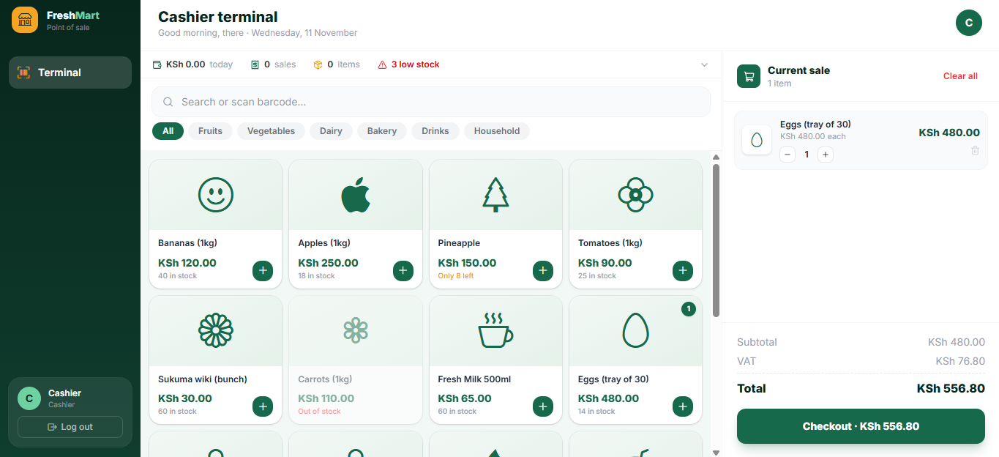
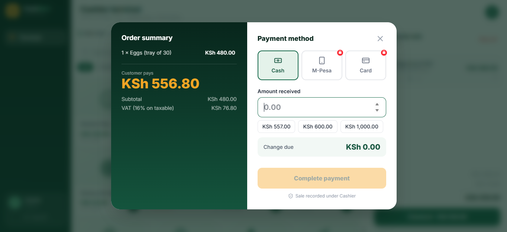
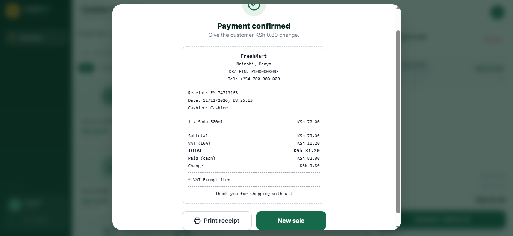
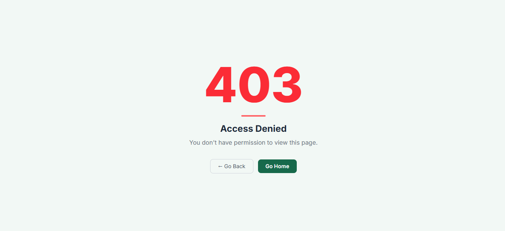

# FreshMart POS

> A modular, Kenya-compliant point-of-sale system for FreshMart — built collaboratively 

---

## Screenshots

### Cashier Terminal
The main screen a cashier sees all day. Products are front and centre. Stats are collapsed into a slim strip at the top so they don't get in the way. Search and category filters are always visible without scrolling.



---

### Cart & Product Selection
Tapping a product adds it to the cart instantly. The cart shows a live running total with VAT broken down per line item. VAT-exempt products (bread, eggs, fresh milk) are clearly labelled.


---

### Checkout — Cash Payment
The checkout modal shows the full order summary on the left and the payment flow on the right. For cash, the cashier enters the amount received and quick-amount buttons make it faster. Change due is calculated live.



---

### Receipt
After payment is confirmed, a clean thermal-style receipt is generated with the store details, itemised list, VAT breakdown, payment method, and change. The cashier can print it directly from the browser.



---

### 403 — Payment Not Connected
M-Pesa and Card payments redirect to this page until your teammate wires the real backend. This prevents cashiers from going through a payment flow that will never complete.



---

## Project Structure

```
src/
├── api/
│   ├── config.js      # API URL, mock flag, WIRED payment flags, stub() helper
│   ├── client.js      # Low-level fetch() wrapper with auth + error handling
│   ├── index.js       # The only file the UI imports from — gateway to mock or real API
│   ├── mock.js        # Fake in-memory backend (no server needed)
│   └── mappers.js     # Normalises raw API responses into consistent shapes
├── components/
│   ├── CartPanel.jsx       # Right-side cart — slide-up drawer on mobile
│   ├── CheckoutModal.jsx   # Payment flow (Cash / M-Pesa / Card)
│   ├── ProductCard.jsx     # Individual product tile
│   └── Sidebar.jsx         # Desktop sidebar + mobile top/bottom nav
├── data/
│   └── products.js    # Seed product data with correct Kenya VAT rates
├── pages/
│   ├── Terminal.jsx      # Main cashier screen — stats, search, product grid
│   ├── NotFound.jsx      # 404 page
│   └── NotAuthorized.jsx # 403 page (shown when payment method not wired)
├── config.js          # Store info (name, address, KRA PIN, phone, locale)
├── utils.js           # VAT constants, money formatter, cartTotals()
├── App.jsx            # Root — auth state, cart state, routing
└── main.jsx           # Entry point — BrowserRouter + route definitions
```

---

## Getting Started

```bash
# Clone the repo
git clone https://github.com/Muigai-Kiongo/Freshmart-Pos.git
cd Freshmart-Pos

# Install dependencies
npm install

# Start development server
npm run dev
```

The app runs on **http://localhost:5173**. No backend needed — the mock API runs entirely in the browser.

---

## Environment Variables

Create a `.env` file in the root to configure:

```env
# Point to your real backend (default: http://localhost:5000/api)
VITE_API_URL=https://api.freshmart.co.ke/api

# Set to false to switch from mock to real backend
VITE_USE_MOCK=false
```

Without a `.env` file the app runs in **mock mode** automatically.

---

## Mock Mode (Default)

The mock API simulates a full backend entirely in memory — no server, no database, no setup.

| Credential | Value |
|---|---|
| Email | `cashier@freshmart.co.ke` |
| Password | `demo1234` |

- Data resets on page refresh
- Stock levels update live as you make sales
- Simulates real network delays so loading states actually show

---

## How the API Layer Works

```
UI Component
    ↓
api/index.js  ← the only file components import from
    ↓
USE_MOCK=true?
    ↓ YES                    ↓ NO
api/mock.js             api/client.js
(fake, in memory)       (real HTTP fetch)
    ↓                        ↓
api/mappers.js  ← normalises both into the same shape
    ↓
Component gets clean, consistent data
```

This means when the real backend is ready, you flip `VITE_USE_MOCK=false` — **zero UI changes needed**.

---

## VAT Rates (Kenya — Finance Act 2023)

| Rate | Applied to |
|---|---|
| 16% Standard | General goods — fruits, vegetables, drinks, household |
| 0% Exempt | Basic food staples — bread, eggs, fresh milk |

VAT is calculated **per line item** based on each product's `vatRate` field, not as a flat rate on the total. Exempt items are labelled on the receipt.

---

## Payment Methods

| Method | Status | How to enable |
|---|---|---|
| Cash | ✅ Working | Always available |
| M-Pesa | ⏳ Not wired | Set `WIRED.mpesa = true` in `api/config.js` once Daraja is connected |
| Card | ⏳ Not wired | Set `WIRED.card = true` in `api/config.js` once gateway is connected |

Clicking an unwired payment method immediately redirects to the **403 page** — the cashier is never left stuck in a broken flow.

---

## Collaboration

Each teammate works on their own branch and opens a Pull Request to merge into `main`.

```bash
# Before starting work — always pull latest from main first
git pull origin main

# Create your branch
git checkout -b your-name/feature-name

# Push your branch
git push -u origin your-name/feature-name
```

### Modules by teammate

| Module | Branch | Status |
|---|---|---|
| POS Terminal + Cart + Checkout | `korir/pos-terminal` | ✅ Done |
| Login / Auth page | — | ⏳ Pending |
| M-Pesa Daraja integration | — | ⏳ Pending |
| Card payment gateway | — | ⏳ Pending |

### Wiring a new endpoint

When your teammate builds a real backend endpoint, they find the matching function in `api/index.js` and replace `null` with the real `request()` call:

```js
// Before (not wired)
export async function login(email, password) {
  return stub("login", () => mockLogin(email, password), null);
}

// After (wired)
export async function login(email, password) {
  return stub("login", () => mockLogin(email, password),
    () => request("/auth/login", { method: "POST", body: { email, password } })
  );
}
```

No UI code needs to change.

---

## Tech Stack

| Tool | Purpose |
|---|---|
| React 19 | UI framework |
| Vite | Build tool + dev server |
| Tailwind CSS v4 | Styling |
| Lucide React | Icons |
| Bootstrap Icons | Product category icons |
| React Router v6 | Client-side routing (404, 403 pages) |
