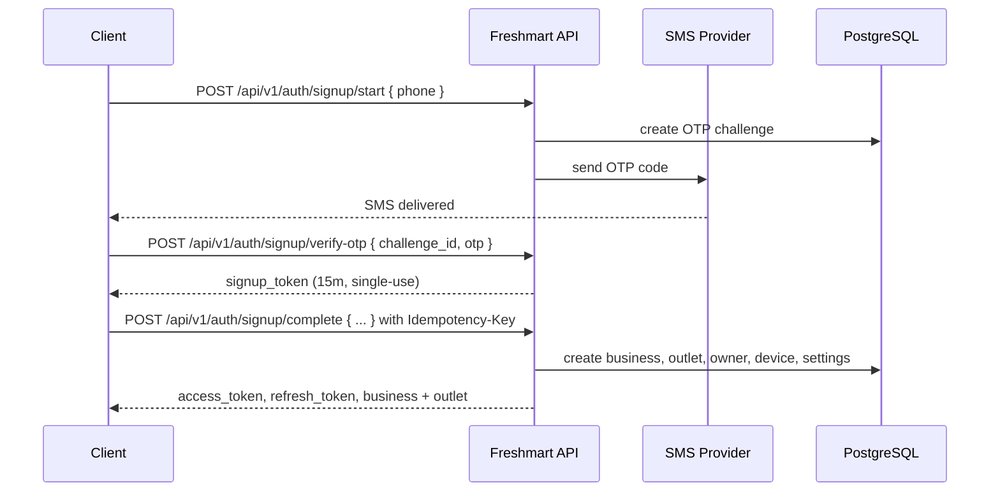
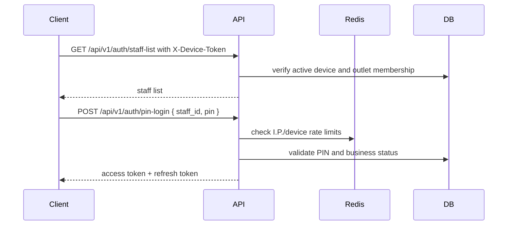
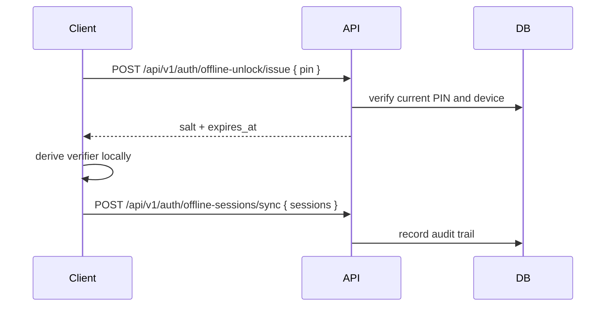
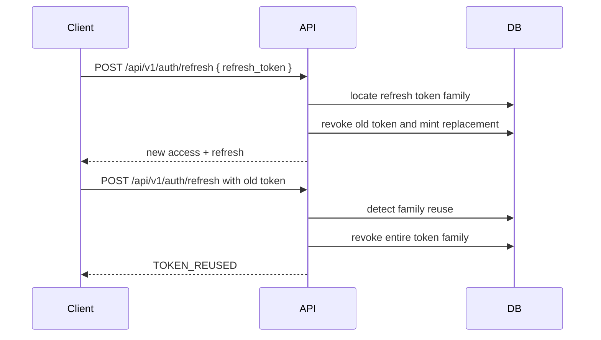
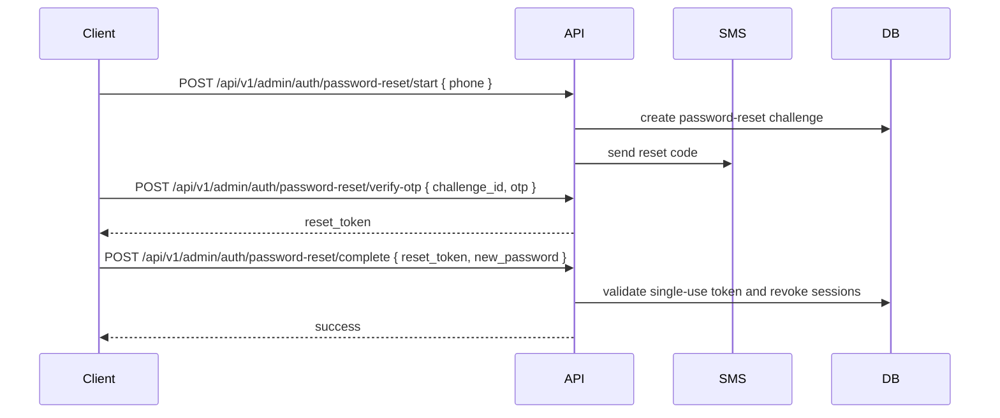
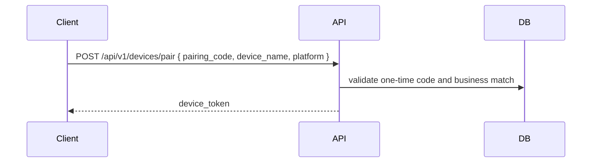

# Authentication flows

## Signup

## PIN login

## Offline unlock

## Token refresh with reuse detection

## Password reset

## Device pairing

## Rate limits and lockouts
| Scope | Rule |
| --- | --- |
| OTP per phone | 3 per hour |
| OTP per IP | 20 per hour |
| OTP global daily | 10000/day |
| PIN login IP | 60/min |
| PIN login device | 30/min |
| Admin login IP | 30/min |
| Password-reset phone | 3/hour |
| Password-reset IP | 20/hour |
| Lockout failures | 5 before lock |
| Lockout duration | 15 min, escalating |
| Staff access token | 15 min |
| Admin access token | 10 min |
| Staff refresh token | 30 days |
| Admin refresh token | 7 days |
| Signup token | 15 min |
| Reset token | 15 min |
| Offline unlock | max 7 days |

## Notes
- The dev OTP code is accepted only in non-production.
- Reset and signup OTPs are never stored in plaintext.
- Admin refresh-cookie transport and CSRF validation are not implemented. `ADMIN_COOKIE_MODE` is a reserved setting and does not activate cookie behavior.
- Device pairing is shown as a future integration flow; no pairing endpoint or pairing-code generation route is currently included.
